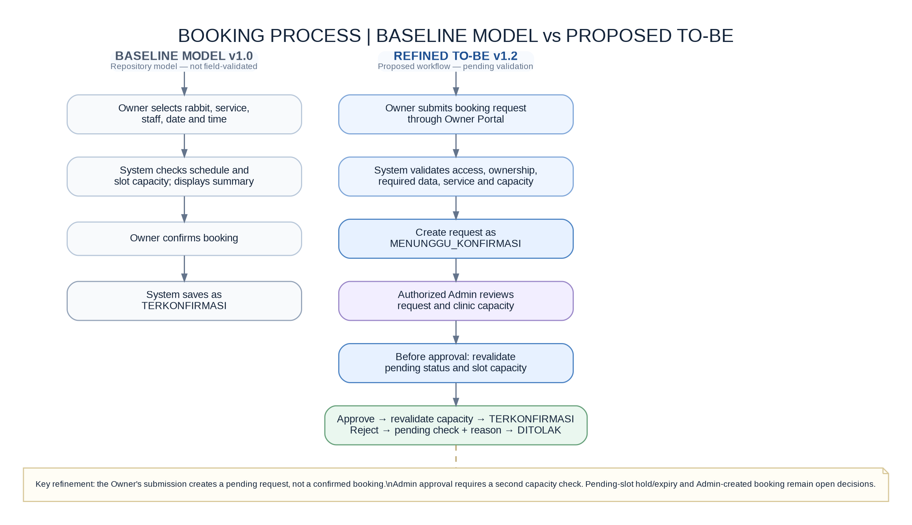
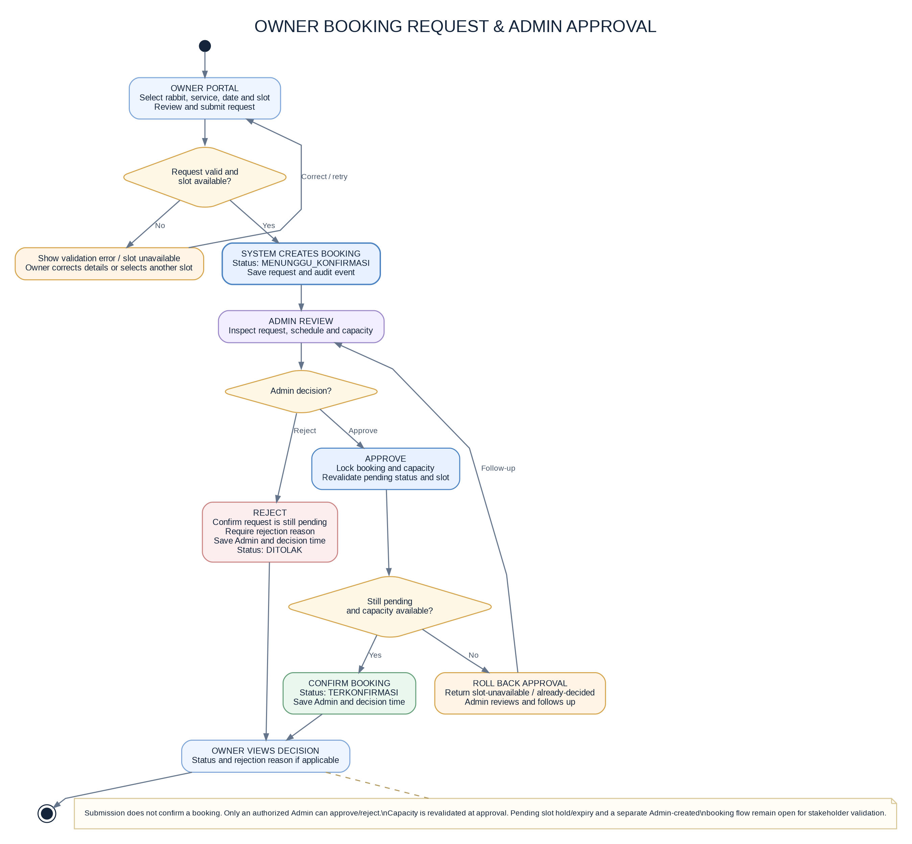
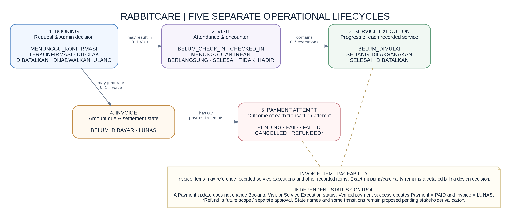
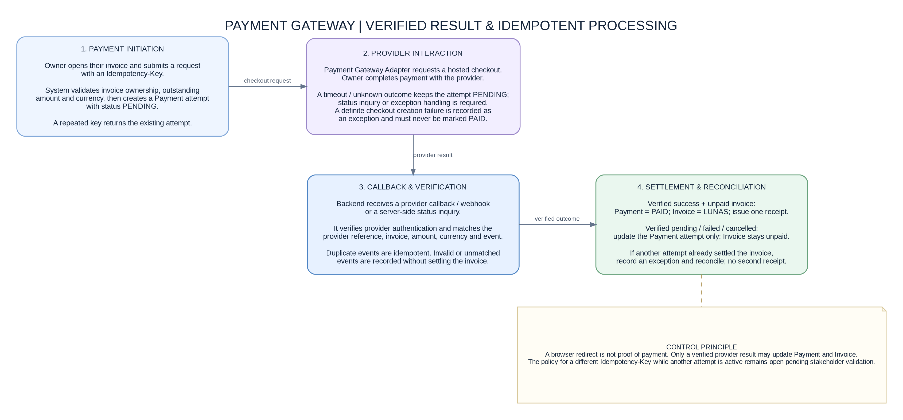

# RabbitCare — Business & System Analysis Case Study

*From baseline workflow assumptions to a structured, traceable system proposal.*

## Project snapshot

| Area | Details |
|---|---|
| Product concept | Web-based rabbit clinic and care management system |
| Domain | Pet healthcare and clinic operations |
| My contribution | Business Analysis and System Analysis |
| Scope | Owner and rabbit profiles, booking, visits, medical records, vaccination, grooming, billing, payment, reminders, and reporting |
| Status | Proposed solution; Draft / pending stakeholder validation |
| Boundary | Analysis and system modeling; no deployed application is claimed |

## Overview

RabbitCare explores how a rabbit clinic could coordinate the owner and patient journey through an integrated information system. The proposed product includes an **Owner Portal** for profiles, booking requests, service history, invoices, and reminders; a **Clinic Operations Portal** for administrative and clinical work; and a **Manager Dashboard** for operational monitoring and reporting.

My contribution focused on analyzing business needs, refining workflows and requirements, and modeling system behavior. The UI prototype is a separate project artifact created by another contributor; I do not claim UI/UX design or application implementation ownership.

## Business context

The project baseline describes potential gaps in how owner and rabbit information, booking requests, staff schedules, medical histories, check-in, billing, payment, reminders, and reporting are coordinated.

These are **repository-based analysis assumptions**, not verified findings from field observation. They require clinic stakeholder validation before being presented as confirmed operational conditions.

The analysis challenge was to translate broad needs into explicit processes, business rules, requirements, data relationships, and system controls.

## My contribution

- **Business and process analysis:** documented business context, stakeholders, objectives, scope, baseline assumptions, and proposed To-Be workflows.
- **Gap and root-cause analysis:** compared baseline and target behavior, organized gaps, and used SWOT and Fishbone Analysis to structure hypotheses and recommendations.
- **Requirements engineering:** prepared and refined BRD, MRD, PRD, and SRD artifacts, including requirements, business rules, priorities, and acceptance criteria.
- **System analysis and modeling:** translated requirements into functional and non-functional considerations, API/data rules, authorization, transaction handling, integrations, audit logging, and PlantUML models.
- **Traceability:** maintained versioned artifacts, refinement addenda, change logs, and links between business, product, and system requirements.

## Key analysis decisions

### 1. Booking submission is a request, not a confirmed appointment

The baseline repository flow moves from Owner confirmation to `TERKONFIRMASI`. The refined proposal introduces an explicit pending-request stage: an Owner submits a request, the system records `MENUNGGU_KONFIRMASI`, and an authorized Admin approves or rejects it. Capacity is revalidated at the approval point.

*Figure 1. Repository baseline model v1.0 compared with the proposed To-Be workflow v1.2. The baseline is not a field-validated clinic process.*

*Figure 2. Owner request and Admin decision workflow, including capacity revalidation before approval.*

**Analysis value:** a submitted request is distinguished from an approved appointment, and the decision actor, timestamp, and rejection reason are recorded.

### 2. Five operational lifecycles are modeled separately

| Lifecycle | Responsibility |
|---|---|
| **Booking** | Owner request, Admin decision, and schedule changes |
| **Visit** | Patient attendance, check-in, queue, and encounter progress |
| **Service Execution** | Progress of each service recorded during a Visit |
| **Invoice** | Amount due and settlement state |
| **Payment Attempt** | Outcome of an individual payment transaction |

*Figure 3. Proposed lifecycle and relationship model. Invoice items may reference recorded services and other billable items; detailed mapping remains a billing-design decision.*

**Analysis value:** completion of a Visit does not automatically mean every service is completed, an invoice is paid, or a payment attempt is successful. Each lifecycle retains its own responsibility and status.

### 3. Payment success depends on a verified provider result

The proposed MVP includes payment gateway integration. Each payment attempt is recorded separately and protected by an `Idempotency-Key`. The backend verifies provider authentication and matches the provider reference, invoice, amount, currency, and event before changing payment or invoice status.

*Figure 4. Payment initiation, provider interaction, callback verification, settlement, and reconciliation controls.*

**Analysis value:** a browser redirect is not proof of payment. Only a verified provider result may set `Payment = PAID` and `Invoice = LUNAS`. Duplicate events must not repeat side effects; invalid or unmatched events must not settle an invoice or issue a receipt.

### 4. Patient history remains traceable to the rabbit

Each rabbit has a unique patient identifier. Medical history remains directly traceable through the rabbit's ID, while Visit and Service Execution records provide context about attendance and individual services.

## Analysis workflow

| Step | Activity | Main outputs |
|---|---|---|
| 01 | Identify business context, actors, objectives, and scope | Business context and stakeholder requirements |
| 02 | Compare baseline assumptions with target behavior | Process comparison, Gap Analysis, SWOT, and Fishbone Analysis |
| 03 | Translate needs into product behavior and rules | BRD, MRD, PRD, priorities, and acceptance criteria |
| 04 | Define system behavior and constraints | SRD, API/data, authorization, transaction, integration, and testing considerations |
| 05 | Model and refine the solution | Use Case, Activity, Sequence, Class, State, Component, and Deployment diagrams |
| 06 | Maintain requirement links and version history | Traceability, refinement addenda, and change logs |

## Deliverables and repository evidence

The repository contains BRD, MRD, PRD, and SRD documents; business analysis artifacts; refinement addenda and change logs; and **49 PlantUML source files** across the original baseline and v1.1/v1.2 refinement set.

Selected evidence:

- [BRD](../requirements/RabbitCare-BRD.pdf) · [MRD](../requirements/RabbitCare-MRD.pdf) · [PRD](../requirements/RabbitCare-PRD.pdf) · [SRD](../requirements/RabbitCare-SRD.pdf)
- [Baseline Gap Analysis](../analysis/RabbitCare-Gap-Analysis.pdf)
- [PRD Refinement v1.2](../refinement/PRD_Refinement_v1.2.md) · [Gap Analysis Refinement v1.2](../refinement/Gap_Analysis_Refinement_v1.2.md) · [SRD Refinement v1.2](../refinement/SRD_Refinement_v1.2_REVISED.md)
- [Booking activity v1.2](../../plantuml/refinement/05_activity_booking_service_v1.2.puml) · [Booking sequence v1.2](../../plantuml/refinement/11_sequence_booking_v1.2.puml)
- [Payment activity v1.2](../../plantuml/refinement/09_activity_payment_v1.2.puml) · [Payment sequence v1.2](../../plantuml/refinement/15_sequence_payment_v1.2.puml)
- [Class diagram v1.2](../../plantuml/refinement/17_class_diagram_v1.2.puml) · [Visit state v1.2](../../plantuml/refinement/22_state_visit_v1.2.puml) · [Service Execution state v1.2](../../plantuml/refinement/23_state_service_execution_v1.2.puml)
- [Baseline-to-To-Be process comparison source](../../plantuml/refinement/24_process_comparison_baseline_to_be_v1.2.puml)

## Outcome, scope, and open decisions

The project produced a structured analysis package connecting business needs and baseline assumptions to proposed product behavior, system requirements, and traceable models. Its main outcomes are an explicit Owner booking request/Admin decision workflow, separate operational and financial lifecycles, and server-side payment verification requirements.

This is a **documented system proposal**, not evidence of a deployed application or measured operational improvement. Baseline conditions and Fishbone causes remain hypotheses. Documents are Draft / pending stakeholder validation. The payment provider, pending-slot hold/expiry policy, Admin-created booking workflow, some Visit and Service Execution transitions, and the policy for a different `Idempotency-Key` while another attempt is active remain open decisions. Cancellation after Service Execution has started is not defined in the current proposal.

## Skills demonstrated

Business Process Analysis · Gap Analysis · SWOT and Fishbone Analysis · Requirements Engineering · Functional and Non-Functional Requirements · Acceptance Criteria · Requirements Traceability · UML / PlantUML System Modeling · Transaction and Integration Analysis · Version-controlled Documentation

---

**Portfolio positioning:** Present RabbitCare as a Business & System Analysis case study. Lead with the process comparison, booking approval workflow, and lifecycle model; use payment verification as the deeper system-analysis example. If the Figma Make prototype is shown, clearly attribute its UI creation to the other contributor.
